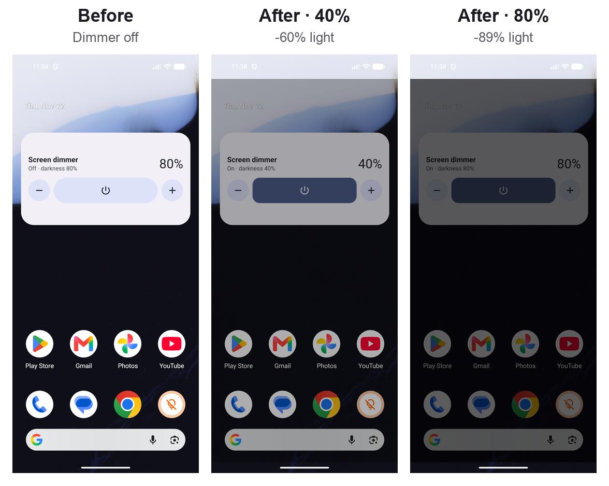
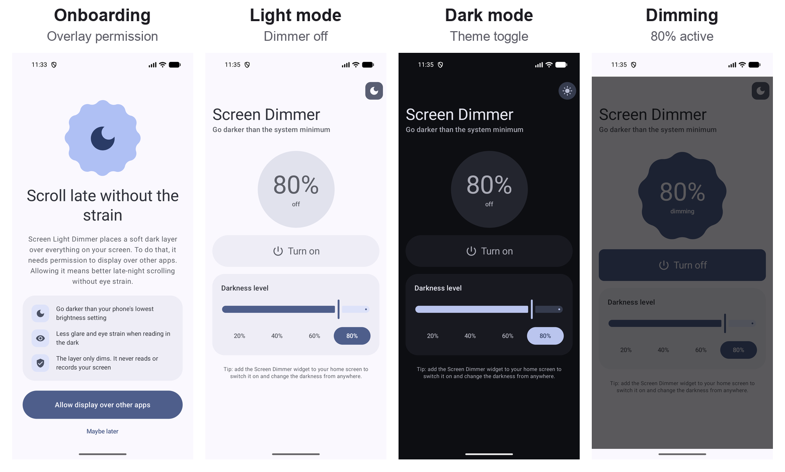

# Screen Light Dimmer

Android app that dims your screen below the system's minimum brightness, for late-night scrolling without eye strain. It draws a soft black layer over everything on screen. You can turn it on and adjust it from the app, the home-screen widget or the notification.



## How much darker?

The figures below come from the screenshots above (Android 17 emulator, home screen with the widget). Each is the average brightness of the screen area under the overlay; the status and navigation bars aren't included, because the overlay doesn't cover them.

| Darkness setting | Overlay opacity | Light emitted | How dark it looks (CIE L\*) |
|---|---|---|---|
| Off | 0 | 100% (baseline) | baseline |
| 40% | 0.32 | **60% less** | about 33% darker |
| 80% | 0.64 | **89% less** | about 65% darker |
| 100% (max) | 0.80 | about 97% less (estimated) | about 80% darker (estimated) |

- **Light vs. look:** "Light emitted" is the measured reduction in light. "How dark it looks" uses the CIE L\* lightness scale, which models how your eyes see brightness: cutting the light in half doesn't make the screen look half as bright.
- **It stacks with system brightness:** the dimmer cuts light on top of whatever brightness you've set. At your phone's lowest brightness, 80% darkness leaves about a tenth of that light.

## Features

| | |
|---|---|
| **Dimming overlay** | A full-screen black layer from 5% to 100% darkness, with a slider and 20/40/60/80% presets. Touches pass straight through to the apps underneath. |
| **Home-screen widget** | Power button plus Darker/Lighter buttons, with the current level shown. It updates whenever the dimmer changes anywhere. |
| **Onboarding** | Explains why the app needs "Display over other apps" and asks for it on first launch. Choosing "Maybe later" goes to the main screen. |
| **Light/dark mode** | Sun/moon button in the top bar. It follows the system theme until you tap it, then remembers your choice. |
| **Material 3 Expressive** | Shape-changing buttons, a level badge that changes shape when the dimmer turns on, expressive motion, and Material You colours on Android 12+. The widget uses them too. |
| **Notification** | Shows the current level while dimming is on, with a one-tap **Turn off** button. |



## Getting started

Requirements: Android Studio with JDK 17+, and a device or emulator running Android 7.0 (API 24) or later.

```bash
./gradlew assembleDebug          # build
./gradlew installDebug           # install on a connected device
./gradlew testDebugUnitTest      # unit tests
```

On first launch, allow **Display over other apps** from the onboarding screen. To add the widget, long-press your home screen → **Widgets** → **Screen dimmer**.

### Permissions

| Permission | Why |
|---|---|
| `SYSTEM_ALERT_WINDOW` | Draw the dimming layer over other apps |
| `FOREGROUND_SERVICE`, `FOREGROUND_SERVICE_SPECIAL_USE` | Keep the layer on screen while you use other apps |

The layer only darkens the screen. It never reads, records or changes what's on it.

## Limitations

- **Status and navigation bars aren't dimmed.** Android doesn't let regular app overlays cover them.
- **Some system screens hide the layer.** Android removes third-party overlays from Settings, permission dialogs and some system apps (such as Files) as a security measure, so those screens show at full brightness.
- **Darkness is capped at 80% opacity.** On Android 12+, an overlay more opaque than that would stop your taps from reaching the apps underneath.

## Architecture

The code is layered and follows SOLID: the UI and widget depend on small interfaces, and one composition root picks the implementations.

```
domain/    DimmerState, DimmerCommand, DimmerStateReducer (pure logic)
           interfaces: DimmerController, DimmerStateRepository, DimmerStateObserver,
                       OverlayPermissionChecker, ThemePreferenceRepository, OnboardingRepository
data/      SharedPreferences implementations and the Android permission checker
service/   DimmerService (foreground service), DimmerOverlay (window), DimmerNotificationFactory,
           ServiceDimmerController, DimmerCommandIntents (command <-> Intent)
widget/    DimmerWidgetProvider, DimmerWidgetRenderer (RemoteViews), WidgetDimmerStateObserver
ui/        Compose screens (stateless), ViewModels, Expressive theme
AppContainer.kt   composition root: the only place that names concrete classes
```

Every change, whether it starts in the app, the widget or the notification, becomes a `DimmerCommand`. `DimmerStateReducer` turns it into the new `DimmerState`. The repository publishes that state, and the screen, the widget and the notification all redraw from it.

## Branching

The project uses GitFlow:
- `main` holds released versions, tagged `vX.Y.Z`.
- `develop` is where new work comes together.
- Work happens on `feature/*`, `chore/*` and `docs/*` branches and merges into `develop` through pull requests.
- Releases are cut on `release/*` branches and merged into both `main` and `develop`.
